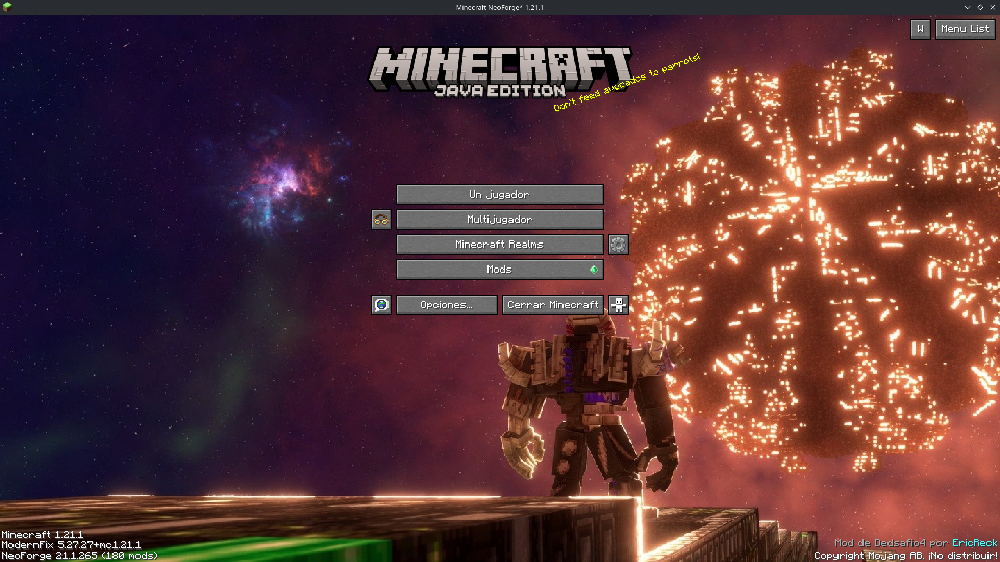

# DEDSAFIO 4 Mechanics (Port a NeoForge)



> **Créditos:** Creador original del mod público de DEDSAFIO 4: **EricReck**.  
> Este repositorio contiene la adaptación y port completo de **DEDSAFIO 4 Mechanics** para **Minecraft** ejecutándose de manera nativa sobre **NeoForge**.

---

## Descripción del autor del repositorio

El mod es actualmente jugable, pero no se recomienda para el uso profesional, hay cosas que arreglar y mejorar (como las animaciones), igualmente esto es una prueba para trastear, se descompiló el mod de **EricReck** y se compiló para usarse en la 1.21.1 (NeoForge) y en principio todo debería de funcionar correctamente.

Muchas gracias a **EricReck** por publicar el mod.
Muchas gracias a **Eufonia** por brindar la serie.
Muchas gracias a **elded** por hacer posible la serie.

---

## 📌 Descripción Original

**DEDSAFIO 4 Mechanics** añade al juego las mecánicas principales de DEDSAFIO 4: eventos temporizados, cambios de dificultad, ruletas visuales, monedas, cajeros automáticos, correo entre jugadores y waypoints.

Los operadores pueden activar retos, preparar un búnker, anunciar instrucciones y cambiar las reglas de supervivencia durante la partida. El evento REVILL presenta un objetivo y una cuenta atrás; quienes no lo completen antes de que termine pueden ser eliminados. También hay una interfaz de control, un fondo animado para la pantalla de título y efectos audiovisuales personalizados.

---

## ✨ Características

- **21 cambios de dificultad** organizados en seis días, desde Creepers electrificados y mobs más peligrosos hasta condiciones ambientales letales.
- **Evento REVILL** con cielo rojo, cuenta atrás, meteoritos y objetivos seleccionables: llegar al búnker, alcanzar Y=250 o descender hasta Y=-250.
- **Ruletas y anuncios visuales** para presentar eventos y cambios durante la partida.
- **Sistema de muerte** que puede poner al jugador en modo espectador y permite que un operador lo restaure.
- **Economía con tres saldos**: Dedita Azul, Dedita Roja y Dedita Verde. El saldo se guarda en el mundo del servidor y se muestra en el HUD.
- **Cajero interactivo**: deposita las monedas físicas compatibles y retira monedas desde tu saldo. Al depositar, 100 Dedita Azul se convierten en 1 Dedita Verde.
- **Buzón** para enviar mensajes y hasta nueve espacios de objetos adjuntos a otro jugador conectado.
- **Waypoints** con nombre, icono, dimensión y distancia. Se pueden crear, editar y eliminar desde el panel.
- Huevo generador de Cajero, bloque de Buzón, Palitomágico y una pestaña creativa propia llamada **"Dedsafio 4"**.
- **Secuencia de Fusión** con animación y sonido, además de un fondo GIF personalizado para la pantalla inicial.

---

## 🚀 Interfaz y Primeros Pasos

1. Instala el mod en la carpeta `mods/` de tu cliente y de tu servidor NeoForge 1.21.1. En un mundo individual, basta con tenerlo en tu instancia.
2. Escribe `/dedsafio4` para abrir el centro de control.
3. **INICIO**: permite seleccionar el color y el mensaje de una ruleta, iniciar una tarea REVILL y detener el evento.
4. **CAMBIOS**: muestra los retos por día. Pulsa **RULETA** en un reto para anunciarlo y activarlo.
5. **WAYPOINTS**: permite crear un marcador en tu posición o con coordenadas, elegir icono y gestionar los marcadores existentes.
6. Para usar el cajero, interactúa con un **Cajero Automático**. Para usar el correo, coloca e interactúa con un **Buzón**.

---

## ⚙️ Comandos de Jugador y Operador

> Los argumentos entre `< >` son obligatorios; los que aparecen entre `[ ]` son opcionales.

### Panel y eventos
- `/dedsafio4` — Abre el centro de control desde un jugador.
- `/dedsafio4 start` — Inicia el evento REVILL con la tarea predeterminada del búnker.
- `/dedsafio4 stop` — Cancela el evento.
- `/dedsafio4 status` — Consulta el estado, tiempo restante, meteoritos y búnker.
- `/dedsafio4 announce <mensaje>` — Envía un anuncio a todos los jugadores conectados.
- `/dedsafio4 color <roja|verde|naranja|rosada|random>` — Lanza una ruleta/anuncio. También acepta `red`, `green`, `orange`, `pink`, `random` y `aleatorio`.
- `/dedsafio4 fusion [entrar|salir]` — Activa, desactiva o alterna la secuencia de Fusión para el servidor.
- `/dedsafio4 revive [jugador] [modo]` — Restaura al jugador en supervivencia o en el modo indicado: `survival`, `creative`, `adventure` o `spectator`.

### Búnker, meteoritos y configuración
- `/dedsafio4 bunker set <x1> <y1> <z1> <x2> <y2> <z2>` — Define las esquinas de la zona del búnker.
- `/dedsafio4 bunker show` — Indica si hay un búnker configurado.
- `/dedsafio4 bunker clear` — Elimina la configuración del búnker.
- `/dedsafio4 meteorites on|off` — Activa o desactiva meteoritos.
- `/dedsafio4 config` — Muestra algunos valores actuales del evento.

### Waypoints
- `/dedsafio4 waypoint add <nombre> [icono]` — Crea un waypoint donde está quien ejecuta el comando. Iconos disponibles en el panel: `star`, `bunker`, `home`, `flag` y `warning`.
- `/dedsafio4 waypoint remove <id|nombre>` — Elimina un waypoint; el panel permite gestionarlos sin escribir su ID.

### Economía (comandos de operador)
- `/dedsafio4 coins` — Abre el menú de gestión de monedas.
- `/dedsafio4 coins add <jugador> <azul|roja|verde> <cantidad>`
- `/dedsafio4 coins remove <jugador> <azul|roja|verde> <cantidad>`
- `/dedsafio4 coins see <jugador>`

### Alias de operador
El árbol `/revill` ofrece `start`, `stop`, `status`, `fusion`, `bunker`, `meteorites` y `config`. Por ejemplo: `/revill start` o `/revill bunker set <x1> <y1> <z1> <x2> <y2> <z2>`. Los comandos bajo `/revill` requieren nivel de operador 2. Varios comandos administrativos de `/dedsafio4` también requieren nivel 2.

### Comandos locales del cliente
- `/fusion` y `/fusion entrar|salir` — Reproducen o cambian el efecto de Fusión en el cliente local.

---

## 📦 Objetos y Bloques

- `dedsafio-4-mechanics:dedita` — Dedita Azul.
- `dedsafio-4-mechanics:dedita_roja` — Dedita Roja.
- `dedsafio-4-mechanics:dedita_verde` — Dedita Verde.
- `dedsafio-4-mechanics:cajero_spawn_egg` — Huevo generador de Cajero Automático.
- `dedsafio-4-mechanics:mailbox` — Buzón.
- `dedsafio-4-mechanics:palitomagico` — Al usarlo sobre un jugador, lo teletransporta a su punto de reaparición.  
*(El tótem vanilla aparece con el nombre NutriTotem).*

---

## 📋 Requisitos para esta versión

- **Minecraft Java Edition**: 1.21.1
- **NeoForge**: 21.1.265 o superior
- **Java**: 21 (LTS) o superior
- En multijugador, instala la misma versión del mod en el cliente y en el servidor.

---

## 🔧 Configuración

El archivo de configuración se genera automáticamente en `config/revill.json`. La configuración inicial usa una duración de evento de 600 segundos (10 minutos), meteoritos activados y destrucción de bloques por meteoritos desactivada. El archivo permite ajustar duración, dimensiones afectadas, anuncios, meteoritos y opciones relacionadas.

---

## 🛠️ Compilación desde el código fuente

Para compilar el proyecto manualmente:

```bash
./gradlew build
```

El archivo compilado `.jar` se generará en `build/libs/`.
